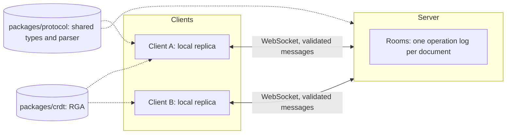
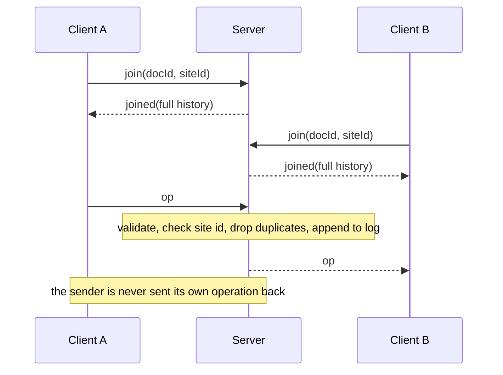

# collab-editor

[](https://github.com/adityakumar-cs24/collab-editor/actions/workflows/ci.yml)

A real-time, offline-first collaborative text editor built around a sequence CRDT implemented from scratch. It is built around one hard problem: when several people edit the same document at the same time (including while offline), every copy must end up identical, with no central server deciding the order of edits.

## What this project demonstrates

Every claim below is backed by a test in this repository.

- **A naive design provably fails.** An index-based implementation diverges on a two-user concurrent edit, silently, with no error (see "The problem").
- **Convergence under random concurrency.** Property-based fuzzing simulates 3 and 10 replicas making random inserts and deletes, with out-of-order and duplicated delivery. Every replica ends with identical text, an empty pending buffer, and exactly one node per insert (nothing lost, nothing duplicated).
- **Convergence through a real WebSocket server.** Two replicas type concurrently over real connections, end with identical text, and a third client that joins later rebuilds the same document from the server's history.
- **Delta sync with version vectors.** A client that rejoins sends what it already has and receives exactly the missing operations. A property test checks that any prefix of a random three-site history, plus the operations the server says are missing, reproduces the full document and an identical vector.
- **Out-of-order delivery is handled.** Operations that arrive before their dependency are parked and applied automatically when it shows up. An 11-character chain delivered in reverse order still produces the right text.
- **Idempotent operations.** Delivering the same operation repeatedly changes nothing, both in the CRDT and on the server.
- **The wire is treated as hostile.** A shared protocol package validates every message on both sides. Malformed JSON, bad ids, oversized messages, binary frames, forged site ids and operations sent before joining are all rejected, and the server stays usable afterwards.
- **An editor session with no DOM.** Text changes are turned into operations by diffing in code points (an emoji counts as one character), and the session is tested against an in-memory stand-in for the server. The page is a thin layer on top.
- **A pure, dependency-free core.** The CRDT has no networking or I/O, so it can be tested exhaustively and shared between client and server.

## Status: CRDT core, protocol, relay server and browser client implemented

114 tests across four packages, run in CI on every push. The client page itself (textarea and WebSocket wiring) is not covered by an automated browser test.

| Package | Tests | Covers |
| --- | --- | --- |
| `packages/crdt` | 36 | ids, clock, RGA, causal buffering, version vectors, multi-replica fuzzing |
| `packages/protocol` | 30 | message validation, version vector validation, limits, round trip with a real replica |
| `apps/server` | 24 | rooms, delta joins, forwarding, ordering and integrity checks, hostile input, end to end |
| `apps/client` | 24 | text diffing, caret shifting, editor session against an in-memory server stand-in, join vectors |

## Roadmap

- [x] Monorepo, TypeScript, Vitest, CI
- [x] Naive index-based version, with a test showing it diverges
- [x] Character ids and Lamport clock
- [x] RGA sequence: insert, delete, tombstones
- [x] Causal buffering and idempotence
- [x] Multi-replica fuzz harness
- [x] Shared protocol with validated parsing
- [x] WebSocket server: rooms, history, validated broadcast
- [x] Browser client (textarea bound to a local replica)
- [x] Version-vector delta sync
- [ ] Reconnect and offline queue
- [ ] Offline queue (IndexedDB)
- [ ] Live cursors anchored to character ids
- [ ] Persistence (PostgreSQL) and multi-instance fan-out (Redis)
- [ ] Benchmarks against Yjs, tombstone compaction
- [ ] Demo video and design document

## Tech Stack

**Used so far:** TypeScript, Node.js, `ws`, Vite, Vitest, fast-check (property-based testing), tsx, pnpm workspaces, GitHub Actions

**Planned:** CodeMirror 6, IndexedDB, PostgreSQL, Redis, Docker Compose

## The problem

Identifying a position by integer index is unstable once other people are editing. Both users start with `ABC`. Alice inserts `X` at index 1; at the same moment Bob deletes the character at index 1 (`B`). Then they exchange operations.

| Design | Alice ends with | Bob ends with | Converged |
| --- | --- | --- | --- |
| Naive (index based) | `ABC` | `AXC` | No, and no error is raised |
| RGA (this project) | `AXC` | `AXC` | Yes |

Bob's "delete index 1" reached Alice after her insert had shifted the text, so it removed `X` instead of `B`. The naive version lives in `packages/crdt/src/naive` with a test that asserts the divergence.

## How it works

- **Every character has a permanent id** `(counter, siteId)`. `siteId` identifies the replica; `counter` is a Lamport clock (incremented on every local operation, and advanced to the largest counter seen from others). Ids are totally ordered: counter first, siteId as the tiebreaker.
- **Operations refer to ids, never indexes.** "Insert Y after character `(2, alice)`" means the same thing on every replica regardless of what else changed.
- **Concurrent inserts after the same character** are ordered by one rule: skip over any following node with a greater id. Every replica applies the same rule, so they agree without talking to each other.
- **Deletes create tombstones.** The node stays in the sequence, marked deleted, so later operations that reference it still resolve.
- **Causal buffering.** An insert is ready when its origin exists; a delete is ready when its target exists. Anything else waits in a pending buffer (deduplicated by operation id) and is applied as soon as its dependency arrives, which can unblock a whole chain.
- **Idempotence.** An insert whose id already exists is ignored; deleting an already deleted character is harmless.

## Architecture



The server is a **relay with a history**, not a replica. It never integrates operations into a document; it stores them in arrival order, forwards them, and replays the log to late joiners. Convergence is the clients' job, which the CRDT guarantees regardless of the order the server delivers things in.



## The wire protocol

| Direction | Message | Meaning |
| --- | --- | --- |
| client to server | `join { docId, siteId, vector }` | Join a document with this replica id; `vector` says what the client already has |
| client to server | `op { op }` | An operation the client created |
| server to client | `joined { docId, ops, vector }` | The operations the client is missing, plus the server's own vector |
| server to client | `op { op }` | An operation another client created |
| server to client | `error { message }` | The last message was rejected |

Both sides parse incoming messages with the same validators in `packages/protocol`. The parser builds new objects from only the expected fields, so unknown extra fields are dropped instead of flowing into the data structures. Limits: 64 KB per client message, 16M characters for a server message (the history on join), document ids `[A-Za-z0-9_-]{1,64}`, site ids up to 64 characters, counters must be safe integers of at least 1, and every insert carries exactly one code point (an emoji counts as one character). A version vector travels as `[siteId, counter]` pairs, not as an object (site ids are untrusted keys), with at most 500 entries from a client and no duplicate sites.

## Server behaviour

- A `siteId` is unique per document while connected, and is freed on disconnect. The same `siteId` can be used in different documents.
- A connection can only send operations carrying its own `siteId`; forged ones are rejected, so nobody can write into another replica's id space.
- Operations are deduplicated by id, so retries are neither stored twice nor broadcast twice.
- Each site's operations must arrive in increasing counter order, because a version vector only summarises "everything up to N" under that rule. An older operation from the same site is rejected.
- The same operation id carrying different content is rejected, because accepting it would make replicas diverge.
- A join is answered with only the operations above the client's vector, plus the server's vector.
- Each document is capped at 50,000 operations (configurable), which keeps the history sent on join within the client's parse limit.
- Binary frames are rejected, and `ws` closes any connection that sends more than 64 KB in one frame (close code 1009).
- The server binds to `127.0.0.1` by default, so a development server is not exposed to the network.

## Verified behaviour

| Scenario | Result |
| --- | --- |
| The `ABC` scenario that breaks the naive version | Both replicas `AXC` |
| Alice inserts `X`, Bob inserts `Y`, both after `A` in `AC` | Both `AYXC` (equal counters, `"bob"` > `"alice"`, so `Y` goes first) |
| Same operations delivered twice | No change, node count unchanged |
| Two replicas delete the same character | Both `ac` |
| Insert arrives before the character it follows | Parked (pending 1), applied when the origin arrives (pending 0) |
| 11 inserts delivered in reverse order | Correct text, pending 0 |
| Delete arrives before the insert it targets | Parked, applied right after the insert lands |
| Same pending operation delivered 3 times | Queued once |
| 100 random delivery orders of a 14 operation history | Identical text every time |
| Fuzz: 3 replicas, up to 100 random actions, 500 runs | All replicas identical |
| Fuzz: 10 replicas, up to 200 random actions, 200 runs | All replicas identical |
| Two clients type "hello" and "world" concurrently through the server | Identical 10-character text on both |
| A third client joins afterwards | Rebuilds the same text, nothing left pending |
| Client A sends an operation | Client B receives it; A is not sent its own operation back |
| Clients in two different documents | Operations never cross between them |
| Same operation sent twice | Broadcast once, stored once, late joiner sees it once |
| Operation carrying another client's `siteId` | Rejected with an error, never forwarded |
| Operation sent before joining | Rejected |
| Second join on one connection | Rejected |
| Second connection claiming a `siteId` already in use in the document | Rejected; allowed in another document and after disconnect |
| Document at its operation cap (2 in the test) | Further operations rejected, log not grown |
| Invalid JSON | Error reply, connection stays usable |
| Binary frame | Rejected |
| 70 KB message | Connection closed with code 1009 |
| Protocol: bad doc ids, site ids, counters of 0, -1, 1.5, "1", multi-character or empty chars, missing origin, unknown types, oversized messages | All rejected |
| Protocol: an extra field on an operation | Dropped from the parsed result |
| Protocol: a joined message containing one invalid operation | The whole message is rejected |
| Operations encoded, parsed and applied to a second replica | Same text |
| Client: typing in one session | Appears in the other |
| Client: replacing a selection | Synced as deletes plus inserts |
| Client: two sessions typing concurrently | Identical text |
| Client: a session joining late | Rebuilds the document from history |
| Client: an emoji inserted and deleted | Counts as one character, synced both ways |
| Client: diff of append, insert, delete, replacement | One exact edit (index, delete count, inserted characters) |
| Client: caret after a remote edit | Before the edit stays, after it shifts, inside a removed range lands after the insertion |
| Client: local edit before joining | Refused |
| Client: server error message | Passed to the error handler |
| Version vector counts local and remote operations, including ones still waiting for a dependency | Verified; duplicates leave it unchanged; it is returned as a copy |
| 300 random three-site histories cut at a random point | The missing operations are exactly the rest of the log; applying them gives the full text and an identical vector |
| Fuzz harness | Now also asserts that all replicas end with identical version vectors |
| Late join with a vector | Only operations above the vector are sent; nothing if up to date; each site tracked separately |
| A client rejoins with its own vector after missing 6 operations | Receives exactly those 6 and ends identical to the writer |
| Operation older than the latest one from the same site | Rejected, not stored |
| Same operation id with different content | Rejected; the original stays |
| Invalid vector (not an array, malformed entry, duplicate site, 501 entries) | Rejected; the connection stays usable |
| Client that knows more than 500 sites | Sends an empty vector (full replay, still correct) |

## Fuzz testing

`packages/crdt/src/testing/simulate.ts` simulates a small distributed system. Each replica has an inbox standing in for the network. A generated history is a list of actions: either a replica edits locally (the operation is queued for every other replica), or a replica takes a random message from its inbox (so delivery is out of order), optionally leaving it there so it is delivered again (duplicates). At the end everything still undelivered is drained in reverse order. For every replica the test then asserts:

1. identical text,
2. an empty pending buffer,
3. node count equal to the total number of inserts.

fast-check generates and shrinks the histories, so a failure is reported as a minimal list of actions plus a seed that replays it.

## Found by testing

The first run of the id tests failed. The property test for antisymmetry reported the counterexample `{18, "a"}` versus `{18, "a"}`: two identical ids. The comparator was right (it returns 0 both ways); the test was wrong. It compared `Math.sign(0)` with `-Math.sign(0)`, and JavaScript distinguishes `+0` from `-0` under `Object.is`. The fix compares with `===`. The failure is kept as a reminder to ask "code or test?" first when a property test fails.

## Running the tests

```
pnpm install
pnpm test        # 114 tests across four packages
pnpm typecheck
```

The server tests are integration tests: each one starts a real server on a free port and connects real WebSocket clients. To prove that something was not delivered without sleeping, a test sends a garbage message and waits for its error reply. A connection's messages are handled in order, so anything the server had sent earlier would have arrived first and failed the test.

CI runs the install, typecheck and test commands on every push.

## Known limitations

- **No reconnect and no offline editing yet.** A client that disconnects cannot reuse its `siteId` until the server notices the old socket closed. A join sends only the operations the client is missing, but a client that knows more than 500 sites falls back to a full replay.
- **The editor binding is a stopgap.** The client works out edits by diffing the textarea value, so typing inside a run of identical characters can attach the new character at the edge of the run instead of where the caret was. The text itself stays correct. Setting the value for a remote edit resets the browser undo history, and carets are shifted by text position rather than anchored to character ids.
- **A page reload creates a new `siteId`**, and there is no reconnect: after a disconnect the page has to be reloaded.
- **The server keeps everything in memory.** A restart loses all documents, and the number of documents is unbounded.
- **The server is a relay and does not check causality.** An operation whose origin or target never arrives is stored and forwarded, and clients will hold it in their pending buffer forever. The pending buffer itself is unbounded.
- **Counters are only checked to be safe integers.** A malicious client could send a huge counter and push every replica's clock to the limit.
- **No authentication, permissions, per-connection rate limiting, heartbeat, or `Origin` check.** Any client that can reach the server can read and edit any document it can name.
- **The fuzz harness models delay, reordering and duplication, but not permanent loss or partitions.** Every operation is eventually delivered to every replica.
- **Linear-time operations.** Lookups scan the node array, local edits filter it, and draining the pending buffer rescans it. Fine for correctness work; the benchmark phase will measure and improve it.
- **Tombstones are never removed**, so memory grows with every deletion. Compaction is planned after it is measured.
- **The CRDT trusts its input.** Validation lives in the protocol layer, not in `Rga` itself.
- **Interleaving behaviour is not tested yet.** Two users typing at the same position can have their characters interleaved; this will be studied and documented.
- **Plain text only.** Rich text is out of scope.

## Design decisions

- **CRDT, not Operational Transformation.** Operations commute, so convergence is a property of the data structure that can be fuzz tested directly, and offline editing needs no central ordering server.
- **The server is a relay with a log, not a replica.** It stays simple and cannot disagree with clients about the document, because it never computes one.
- **Zero-dependency core.** `packages/crdt` has no I/O, so the same code runs in the browser and on the server.
- **Validate on both sides of the wire.** Clients parse server messages with the same strict parser, instead of trusting the server.
- **A `siteId` is bound to a connection.** This closes the "assumed unique" gap in the CRDT layer by enforcing uniqueness per document and preventing forged operations.
- **Deletes get their own operation id**, so every operation is identifiable, which version vectors rely on.
- **The server enforces per-site increasing order.** That rule is what lets a single counter per site stand for "everything up to here", and it is checked on the server rather than assumed.
- **One code path for local and remote operations.** Local edits go through the same `integrate` method as remote ones, so the fuzz tests exercise what users actually run.
- **Fuzz harness kept outside the test file** so later phases (partitions, offline) can reuse it.
- **Strict TypeScript** with `noUncheckedIndexedAccess`, because index-heavy data structure code is full of "this element might not exist" bugs.
- **Dependency install scripts are denied by default.** pnpm blocks them until approved. The one that asked (`esbuild`, pulled in by `tsx`) is explicitly denied in `pnpm-workspace.yaml`, and the dev server and tests run fine without it.

## Project structure

```
packages/
  crdt/
    src/
      id.ts            character ids and total order
      clock.ts         Lamport clock
      rga.ts           the sequence CRDT
      vector.ts        version vectors and delta computation
      naive/           the index-based version that fails
      testing/         multi-replica simulator
      *.test.ts        unit, property and fuzz tests
  protocol/
    src/
      messages.ts      message types and limits
      parse.ts         validating parsers for both directions
      vector.ts        version vector wire format helpers
apps/
  server/
    src/
      server.ts        WebSocket server: rooms, history, broadcast
      main.ts          entry point (PORT and HOST environment variables)
      test-helpers.ts  test client
  client/
    index.html         the page
    src/
      diff.ts          text diffing in code points, caret shifting
      session.ts       editor session: text changes to operations, server messages to text
      main.ts          DOM and WebSocket wiring
bench/                 (planned) benchmarks
docs/                  (planned) design notes
```

## Running locally

```
pnpm install
pnpm --filter @collab/server dev     # ws://127.0.0.1:8080
pnpm --filter @collab/client dev     # http://localhost:5173/?doc=demo (second terminal)
```

Set `PORT` and `HOST` to change where it listens. It binds to localhost unless you say otherwise.
